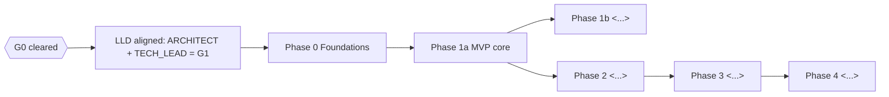

<!-- Reference copy from the Remitly pilot, scrubbed on 2026-11-07. Do not use directly; see core/ for the generic version. -->
<!-- Skeleton only: section headers, table column headers and at most two example rows per table. Product details replaced by <...>. Extracted from PLAN.md (260 lines) on 2026-11-07. -->
# PLAN

Work breakdown for <product>. Derived from `docs/HLD.md` §<n> and §<n>. Live status is **not** kept here: see `PROGRESS.md`. This file changes only when scope, order or acceptance changes (ARCHITECT edits; others request via `PROGRESS.md` §6).

| | |
|---|---|
| **Version** | <n.n> (<what changed and the DEC ids that caused it>) |
| **Last updated** | <YYYY-MM-DD> |
| **Basis** | PRD v<n>, HLD v<n> (<stack decision DEC id>), `docs/lld/data-model.md` v<n>, `docs/LLD.md` v<n> |

---

## 1. Plan at a glance



| Phase | Outcome | Exit criteria |
|---|---|---|
| **Design** | LLD aligned (G1) | <design deliverables that must exist: data model, LLD with rules spec, API tables, generated API baseline, task breakdown T-x.y.z for the first phases> |
| **0 Foundations** | Secure, observable skeleton | <pipeline green, environment deployed, access control and audit proven by tests> |

## 2. Gates

| Gate | Condition | Owner | Unblocks |
|---|---|---|---|
| **G0** | Founder approves HLD, PRD amendments, assumptions | FOUNDER | LLD (cleared <YYYY-MM-DD>, DEC-NNNN) |
| **G1** | ARCHITECT and TECH_LEAD both send `ALIGNED` on the LLD (DEC-NNNN). **Cleared <YYYY-MM-DD> (DEC-NNNN)** | ARCHITECT + TECH_LEAD | Task split; SENIOR_ENGINEER-1/2 start |

## 2b. Execution model

| Level | Who creates it | Who executes | ID |
|---|---|---|---|
| **Work package (WP)** | ARCHITECT (this file + build brief) | owned by TECH_LEAD during build | `WP1.4` |
| **Engineer task** | TECH_LEAD, using the task brief in `agents/TECH_LEAD.md` | one SENIOR_ENGINEER instance | `T-1.4.1`, `T-1.4.2` |

Flow per work package: ARCHITECT issues the build brief → TECH_LEAD confirms contracts (schema, API, shared types) and splits it into non-overlapping tasks → engineers build in parallel, each owning distinct files → each submits a report → TECH_LEAD reviews (verdict), integrates, runs the full suite → **QA verifies independently and gives a verdict (from Phase 1a)** → TECH_LEAD marks the WP `IN_REVIEW` → ARCHITECT checks conformance to the brief → `DONE`. Phase exits (G3 and later) also need a QA phase sign-off.

The "Owner" column below is the *design/delivery owner*. During build the owner of every WP in Phases 0–2 is **TECH_LEAD** (supervising engineers); ARCHITECT remains owner of WP-D\* and conformance review.

## 3. Work packages

Estimates are relative effort, not calendar commitments: **S** ≤ 3 days · **M** ≤ 1.5 weeks · **L** ≤ 3 weeks (one engineer-equivalent).

### Design

| ID | Title | Owner | Depends on | Size | Deliverable | Acceptance |
|---|---|---|---|---|---|---|
| WP-D1 | LLD: data model | ARCHITECT | G0 | M | `docs/lld/data-model.md` | <every HLD entity present; constraints, indexes, validators, scope and audit design specified> |
| WP-D6 | Task breakdown and briefs, Phase 0–1a | TECH_LEAD | G1 | S | `docs/LLD.md` §<n> + one task brief per task in `docs/briefs/` | Each: goal, scope, FR/rule IDs, owned files, contracts, acceptance, tests, out-of-scope |

### Phase 0: Foundations

| ID | Title | FR / refs | Depends on | Size | Acceptance |
|---|---|---|---|---|---|
| WP0.1 | Repo, CI/CD, environments, observability baseline | HLD §<n> | G1 | M | <pipeline green on PR; deploy works; a request produces a trace and a structured log; boundary lint active> |
| WP0.2 | Identity, roles, scoped data access, audit | FR-<x.y>; ADR-<nnn> | WP0.1 | L | <login works against test IdP; per-role access matrix proves scope on every route; audit written in the same transaction; boundary violations fail CI> |

### Phase 1a: MVP core

| ID | Title | FR / refs | Depends on | Size | Acceptance |
|---|---|---|---|---|---|
| WP1.1 | <feature> | FR-<x.y> | WP0.2 | M | <testable statements> |
| WP1.3 | <pure rules package with full test suite> | PRD §7.<x>; ADR-<nnn> | none (parallel) | L | <all specified cases pass; no I/O imports; clock injected; coverage ≥ 95% on the package> |

### Phase 1b

| ID | Title | Refs | Depends on | Size | Acceptance |
|---|---|---|---|---|---|
| WP1b.1 | <...> | <...> | <...> | <S/M/L> | <...> |

### Phase 2 (briefs written: `docs/briefs/WP2.md`, DEC-NNNN; <provisional defaults noted>)

| ID | Title | Refs | Depends on | Size | Acceptance |
|---|---|---|---|---|---|
| WP2.1 | <...> | <...> | <...> | <S/M/L> | <...> |

### <Further phases and cross-cutting tracks, one table each, same columns>

## 4. Critical path

`G1 → WP0.1 → WP0.2 → WP1.1 → <...>` (task-level critical path and parallel tracks: `docs/LLD.md` §<n>)

Parallel tracks: <which WPs can start independently; which external gate must be requested early because it gates later work>.

## 5. Definition of done (all work packages)

1. Every acceptance item above has recorded evidence in `PROGRESS.md`.
2. Unit tests for any business rule touched; integration tests run on a real database (Testcontainers); no mocked or in-memory database.
3. New state-changing paths are audited and covered by an authorization test per role.
4. <product-specific data invariants, e.g. money and date rules>.
5. Structured logs/metrics/traces added; no PII in logs.
6. Documentation updated (`docs/`) and any design deviation recorded as a decision in `PROGRESS.md` §8.
7. From Phase 1a on, every WP with user-visible or API behaviour has a **QA verdict** (QA Pass, or Pass with conditions with a date) recorded in PROGRESS; no open S1/S2 defects on the WP (QA role: `agents/QA.md`; test plans in `docs/qa/`).
8. Every task approved by TECH_LEAD (verdict recorded in `PROGRESS.md` §7b), full build and test suite run by TECH_LEAD after integration.
9. Reviewed by ARCHITECT against the build brief.

## 6. Briefs

**ARCHITECT build brief** (one per WP) and **TECH_LEAD engineer task brief** (one per task, template in `agents/TECH_LEAD.md`) are separate. The task brief must add: files the engineer owns, files not to touch, and a "report back with" line matching the engineer report format in `agents/SENIOR_ENGINEER.md`.

### 6.1 Build brief template (used for every WP)

```markdown
# WP<id>: <title>
**Summary (plain language):** 3–5 lines.
**Goal:**
**Scope (in):**
**Out of scope:**
**Requirements:** FR-x.y, PRD §7.x, ADR-NNN
**Interfaces / contracts to implement:** endpoints, tables, events, function signatures
**Acceptance criteria:** testable statements
**Test requirements:** unit / integration / E2E cases
**Dependencies and inputs:**
**Risks / notes:**
```

## 7. Change control

Scope or acceptance changes are made only by ARCHITECT, after a `CHANGE_REQUEST` message in `PROGRESS.md` §6 and, if it alters the PRD, founder approval. Record the change in `PROGRESS.md` §8 (decision) and bump the version and date at the top of this file.
